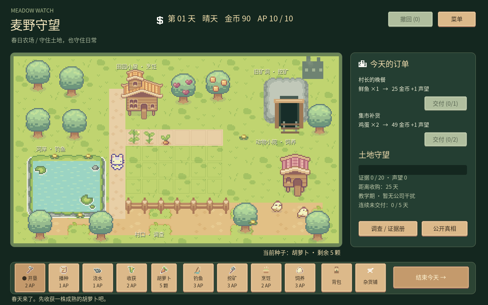

# 麦野守望 · Meadow Watch

基于《回合制种田游戏想法》的 Godot 4.7.2 可玩原型。每天分配 10 AP，在经营农场与调查黎明工业之间选择；25 天内收集 20 份证据并主动公开真相。



双击 `启动游戏.bat` 直接游玩；双击 `打开编辑器.bat` 继续开发。也可在指定 Godot 中导入 `project.godot`，按 F6/F5 运行主场景。项目无需第三方插件或联网。

## 操作

- 下方选择开垦、播种、浇水、收获，再点击农田。数字 1–4 切换工具。
- 鼠标悬停地块、小屋、矿洞、水塘、动物小院时，鼠标旁即时显示动作、AP 消耗、材料与不可执行原因；可执行地点显示手形，耕作显示十字，条件不足显示禁止光标。提示框不拦截点击，打开菜单时隐藏。
- 种子袋切换 8 种作物；杂货铺买种子、升级 4 类农具（各 5 级）。
- 工具栏上方常驻显示当前种子和剩余数量，种子切换按钮也显示名称与数量；播种、购买、读取和撤回后自动刷新。
- 工具栏包含动作图标；播种按钮显示对应种子袋，种子选择按钮显示对应成熟作物，并随八种作物的选择切换。优先使用 Sprout Lands 物品切片，钓鱼、料理和背包使用项目内 SVG 图标。
- 人物以脚底为锚点站在道路中央，沿道路在五个停留点间随机走动，配合方向动画与停顿；此为氛围演出，不消耗 AP，也不影响经营随机事件。
- 点击河岸 / 矿洞 / 小屋 / 动物小院，或工具栏的钓鱼 / 挖矿 / 烹饪 / 饲养。
- 背包出售物资，食用田园热饭恢复 5 AP。烹饪每天一次，消耗 1 鲜鱼或 2 份同种作物。
- 每天交付订单，结束今天时维护费 8 金币。小雨自动灌溉，浇水的作物跨天生长。
- 调查每次 4 AP，每处每天一次；前 10 天每次 +2 证据，之后 +3。
- 证据达到 20 后点击公开真相，选择媒体、监管部门或和解。
- Esc 关闭弹窗/打开菜单，F5 保存，F9 读取。成功行动后自动存档。
- 点击主界面或弹窗右上方「撤回」，或按 Ctrl+Z，连续撤回当天的成功操作；AP、物资、金币、作物、工具、订单、证据及事件状态一起恢复。失败的操作不占撤回步数，撤回也会自动保存。结束当天或公开真相后清空记录。
- 撤回记录随存档保存，重新读取后仍可撤回。旧版本存档兼容读取，但更新前的操作没有历史快照，无法追溯撤回。
- 杂货铺显示当前金币、矿石与各类种子持有量；升级费用为金币与矿石同时支付，资源不足或满级时按钮禁用。

首日建议：收获现成胡萝卜 → 钓鱼 → 交付鲜鱼订单 → 给未成熟作物浇水。日常可采用「钓鱼 3 AP + 调查 4 AP + 农事 3 AP」。在第 10 天左右即可达成结局，也可经营更久。

## 已实现

24 地块，8 作物；10 AP 回合；雨天；作物分阶段生长；资源背包；经济交易；每日两个订单；矿石与工具升级；鸡蛋生产；料理恢复；6 类公司事件；3 处调查和证据册；3 种主动结局和 3 种失败原因；剧情弹窗；原子替换 JSON 存档（含随机数状态与输入校验）；中文 UI；程序合成音乐与操作音。

这是固定视角策略原型。文档设想的两小时叙事、NPC 长篇对话、拖拽物品、三类动物和结局动画尚未制作；当前畜牧为鸡，结局以文字演出。破坏作物事件会清空一格，可重新播种；污染事件降低鱼获，作物灌溉仍使用清水。

## 结构与复用

- `scripts/farm_state.gd`：可独立运行的回合数据与规则、存档；通过信号通知界面。
- `scripts/farm_view.gd`：像素农场、精灵切片、地点和地块点击。
- `scripts/main.gd`：中文界面、菜单、剧情、输入、自动保存与音频。
- `scenes/main.tscn`：主场景。
- `assets/themes/farm_theme.tres`：主场景 Theme 属性直接引用的主题。按钮普通、悬停、按下、禁用、焦点状态均使用 Sprout Lands UI 精灵表的 StyleBoxTexture 九宫格；`PrimaryButton` 与 `SelectedTool` 是主题类型变体。可在 Godot 检查器中直接修改切片与边距。
- `tests/simulation.gd` / `tests/ui_smoke.gd`：规则与完整输入链冒烟。

复用笔记库《Godot-种植系统设计》的作物数据和浇水记录思想，改为按回合结算；复用《Godot-信号解耦游戏状态机架构》的事件通知方案、《Godot-Theme主题系统与自定义按钮样式》的 StyleBoxTexture 九宫格主题方案。笔记中示例属于旧 TileMap/实时成长模型，因此按当前玩法改写，没有直接拷贝不兼容接口。

地图的水塘使用草地边缘切片组成像素岸线，水面动画同相位平铺；荷叶与岸石来自 Water Objects。矿洞以 Stone Ground Hills 组成山体，叠加代码绘制的像素洞口、木支架与轨道；封锁时显示路障。栅栏使用独立左端、中段与右端切片，避免重复端头。

## 验证命令

```powershell
$engine = 'D:\软件安装程序\Godot\Godot_v4.7.2-stable_win64_console.exe'
& $engine --headless --path . --editor --import --quit
& $engine --headless --path . --script tests/simulation.gd
& $engine --headless --path . --script tests/ui_smoke.gd
& $engine --headless --path . --script tests/undo.gd
& $engine --path . -- --capture
```

图形模式 `--capture` 生成 `docs/gameplay.png` 和 `docs/shop.png` 后退出，不保存玩家进度。UI 测试显式禁用自动存档；规则测试使用独立临时存档，不覆盖玩家进度。

## 资源署名与本地字体

Assets — Sprout Lands, by **Cup Nooble**。使用用户提供的 Sprout Lands Premium Sprites / UI 包。原授权文本保留于 `assets/sprites/read_me.txt` 和 `assets/ui/read_me.txt`。仅保留游戏引用的资源，不作为素材包再次分发。

音乐与操作音为本项目程序合成。中文字体为 [Noto Sans CJK SC](https://github.com/notofonts/noto-cjk)，采用 SIL Open Font License 1.1，完整许可证位于 `assets/fonts/OFL.txt`。原本用于本地原型的微软雅黑不进入仓库。
